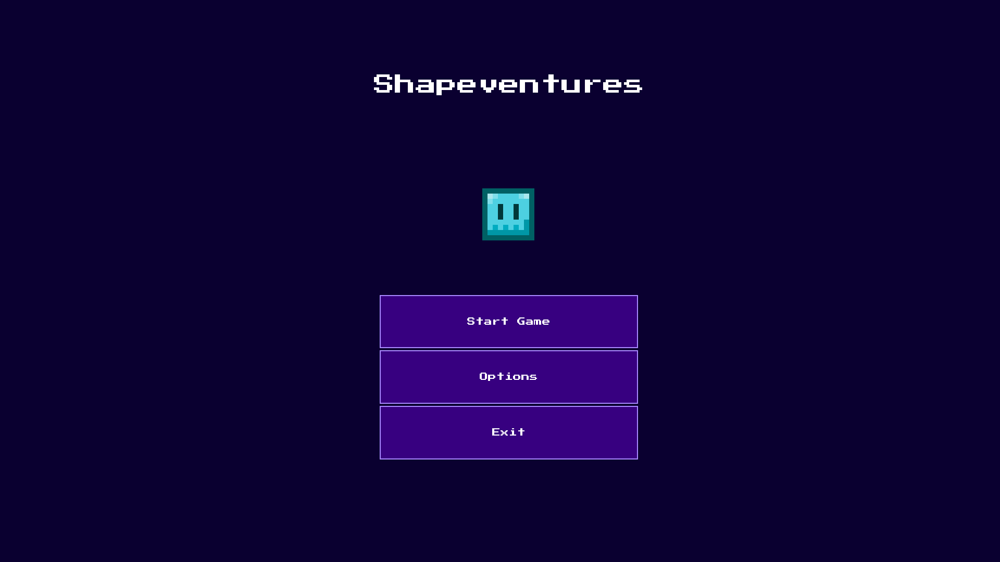
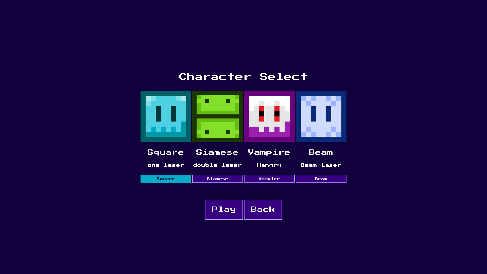
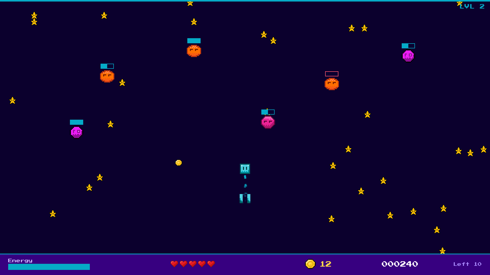
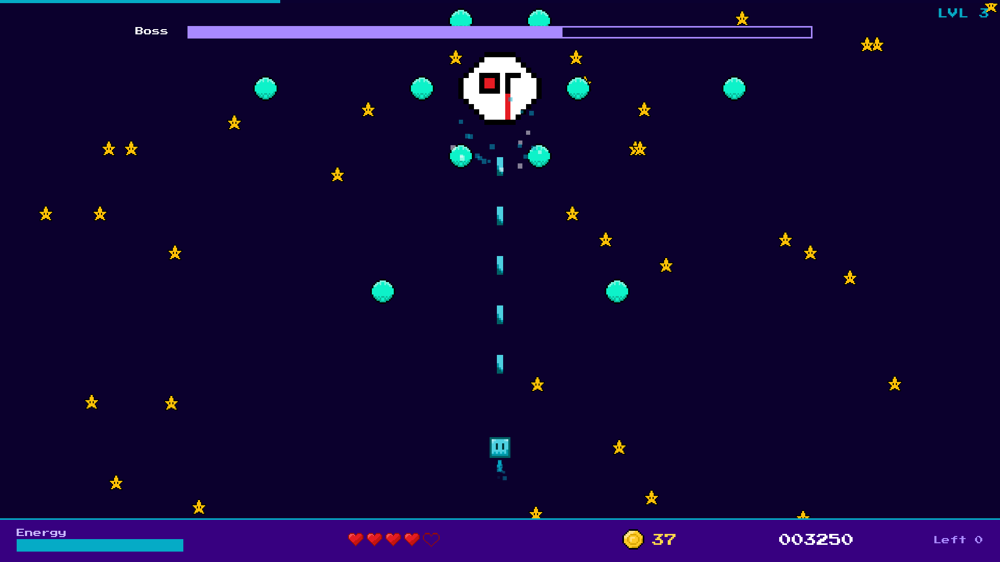

# Shapeventures

A pixel art arcade shooter built with Godot 4 and GDScript. Guide your shape through waves of enemies, collect loot, and defeat the boss at the end of the level.

**Work in Progress** — actively developed, expect frequent updates.

---

## Screenshots

| Main menu | Character select |
|---|---|
|  |  |

| Gameplay | Boss fight |
|---|---|
|  |  |

---

## Gameplay

Shapeventures is a vertical scrolling shooter with a twist: each playable character has a unique mechanic that changes how you approach combat. The screen scrolls upward constantly, so keep moving.

Defeat 25 enemies and the boss appears. Beat it to complete the level.

---

## Characters

| Character | Speed | HP | Playstyle |
|---|---|---|---|
| Square | Normal | 5 | Balanced. Dual laser, standard energy |
| Siamese | Fast | 4 | Twin rectangles that must flip to reload, alternate between two firing sides |
| Vampire | Medium | 3 | No weapons. Touch enemies to devour them and heal |
| Beam | Slow | 4 | Fires a continuous energy beam, manage your charge carefully |

---

## Enemies

| Enemy | HP | Behaviour |
|---|---|---|
| Light Enemy | 2 | Drops straight down, can drop loot |
| Fast Enemy | 2 | Crosses the screen diagonally from either side, drops a bomb on death |
| Big Enemy | 6 | Slowly descends and shoots circular bullet patterns |
| Boss | 20 | Zigzags across the top, fires bullet rings and a rotating beam |

Every enemy has a health bar above it that turns red when it is nearly dead. The boss health bar is shown at the top of the screen.

---

## Features

- Vertical scrolling shooter with auto-scroll mechanic
- 4 playable characters with unique mechanics
- 3 enemy types and a boss fight with individual health bars
- Shield system with limited charges, blocks one hit per charge
- Energy system per character, shooting costs energy that recharges over time
- XP and level system, score tracking
- Loot drops: hearts, shield charges, coins
- Particle effects: hit sparks, explosions, engine trail, loot pickups
- Pixel art HUD with energy, health, shield, coins, score, and enemies left
- Pause menu, game over, and victory screens
- Pixel art assets created in Aseprite
- Scrolling star background

---

## Controls

| Action | Key |
|---|---|
| Move | WASD (also Left / Right Arrow Keys) |
| Shoot | Left Mouse Button |
| Beam | Right Mouse Button (Beam only) |
| Flip | E (Siamese only) |
| Shield | Middle Mouse Button |
| Pause | Escape |

---

## Planned Features

- Web version (itch.io or similar)
- More levels
- Additional characters
- Animated explosions (spritesheet)
- Sound effects and music
- High score system
- More loot types
- Level select screen

---

## Tech Stack

| Tool | Purpose |
|---|---|
| Godot 4.7 | Engine |
| GDScript | Scripting |
| Aseprite | Pixel art |
| FL Studio | Music |

---

## Project Structure

```
res://
├── assets/         sprites
├── audio/          music and sound effects
├── font/           Press Start 2P and its license
├── global/         Global autoload (score, XP, characters)
├── images/         README screenshots
├── scene/
│   ├── player/     player scenes per character
│   ├── enemy/      enemy and boss scenes
│   ├── loot/       loot drop scenes
│   ├── weapons/    lasers and beams
│   ├── ui/         menu, HUD, pause, game over, victory
│   └── main.tscn   main game scene
├── script/         all GDScript files
└── theme/          UI theme (button styles)
```

---

## Running the Project

1. Install [Godot 4.7](https://godotengine.org/download).
2. Open the project folder with the Godot project manager.
3. Press F5 to run.

### Missing audio files

The following audio files are not part of this repository (see `.gitignore`), so a fresh clone will show missing-resource warnings and play without these sounds:

| File | Used for |
|---|---|
| `audio/01.04.2026_synthwave.wav` | Background music (original song, too large for GitHub) |
| `audio/SPACEPHONE LASER - Hit Chirp SpringSOUND - TWISTED TOOLS.wav` | Laser shot sound (third-party sample) |
| `audio/FX41.wav` | Sound effect (third-party sample) |

To add your own, place files with these names in `audio/`.

---

## License

| Part | License |
|---|---|
| Source code (GDScript, project files) | [MIT](LICENSE) |
| Artwork, pixel art, music | All rights reserved. May **not** be used, copied, modified, or redistributed without prior written consent |
| Font (Press Start 2P) | SIL Open Font License 1.1 (see `font/OFL.txt`) |

### Credits

- Font: [Press Start 2P](https://fonts.google.com/specimen/Press+Start+2P) by CodeMan38, licensed under the SIL Open Font License 1.1 (see `font/OFL.txt`).
- Engine: [Godot Engine](https://godotengine.org), © Juan Linietsky, Ariel Manzur, and contributors, licensed under the MIT License.
